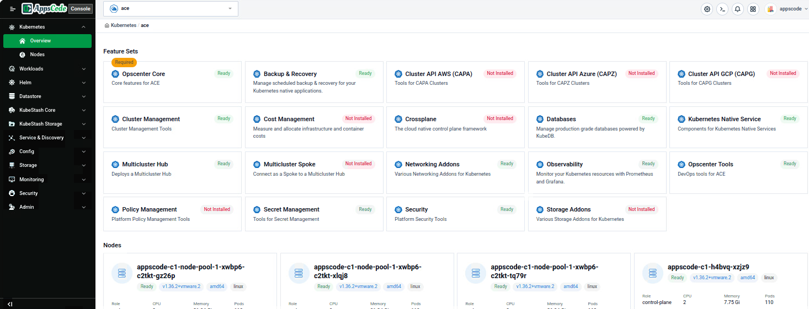
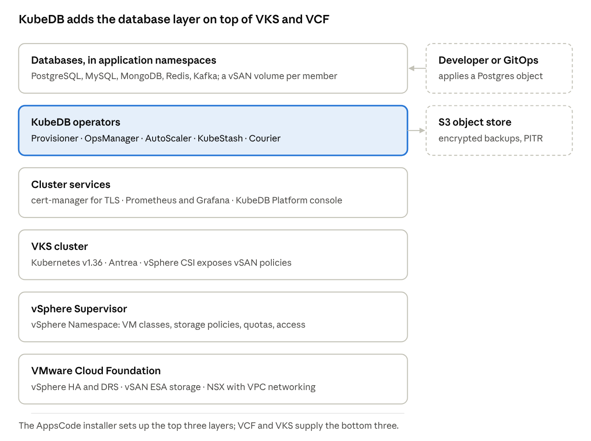
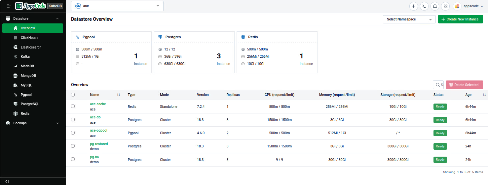
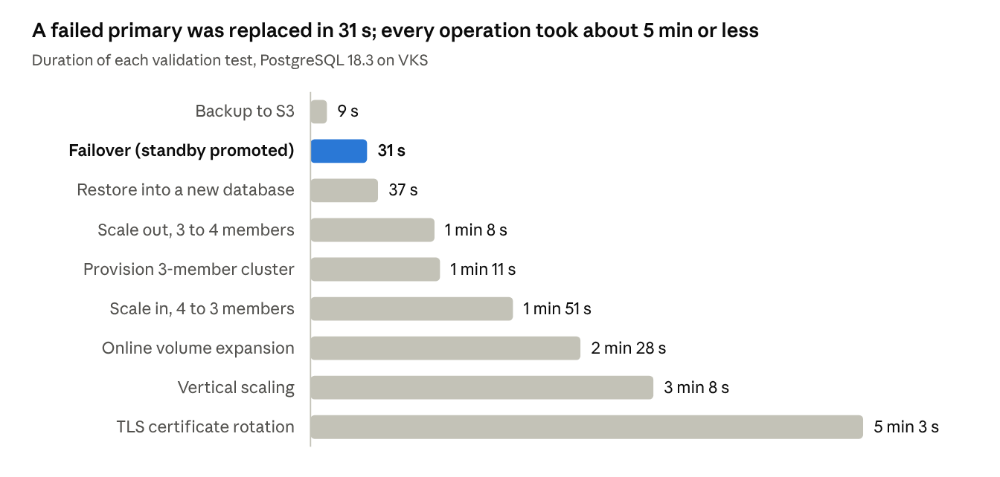

# Database-as-a-Service on VMware Cloud Foundation with VKS and KubeDB

October 2026 · Arnob Kumar Saha, AppsCode

VMware Cloud Foundation (VCF) runs VMs and containers on one platform, and vSphere Kubernetes Service (VKS) gives teams Kubernetes clusters on demand. The next ask is *databases* on demand. **KubeDB Platform is now validated on VKS**, so VCF customers can run a Database-as-a-Service (DBaaS) on infrastructure they already own.

Hyperscaler database services work *only inside their own cloud*, each with its own APIs, tooling, backups and hard-to-predict costs, and they're often ruled out for regulated, sovereign or air-gapped sites. Running databases by hand on Kubernetes avoids that lock-in but brings back ticket-driven operations. KubeDB automates the databases instead, and its resources run on any conformant cluster, so hybrid estates get **same database API style everywhere**, with VCF as the validated home for the data they keep on premises. AppsCode and VMware published the validated stack as a reference architecture.

## VKS runs the clusters, KubeDB runs the databases

VKS provides CNCF-conformant Kubernetes clusters governed with the same vSphere tools and policies teams already use for VMs. For databases, that foundation matters: vSAN storage policies decide how each volume is protected, NSX isolates and load-balances database traffic, vSphere HA and vSphere Zones keep the nodes available, and vSphere Namespaces with vCenter Single Sign-On control who can create clusters. **The vSphere administrator keeps those controls; application teams get self-service inside them.**

KubeDB adds one Kubernetes custom resource per database engine and operators that automate the whole database lifecycle. It covers **more than 30 engines**, including PostgreSQL, MySQL, MongoDB, Redis, Kafka and Elasticsearch. The KubeDB Platform builds on the operators with a web console for self-service provisioning and day-2 operations, plus multi-cluster management across VKS clusters and clusters elsewhere. Multi-cluster management is built on [Open Cluster Management (OCM)](https://open-cluster-management.io): a hub cluster registers VKS and other clusters as spokes and manages their databases from one console.



<br>

| Area | VKS on VCF provides | KubeDB adds |
| --- | --- | --- |
| Platform | Conformant Kubernetes clusters with automated provisioning and upgrades | Database operators for 30+ engines |
| Storage | vSAN storage policies exposed as StorageClasses through vSphere CSI | A persistent volume per member, online volume expansion, storage autoscaling |
| Networking | NSX and VPC networking, load balancing, Antrea | Primary and standby Services, per-database network policies |
| Security | vSphere Namespaces, vCenter Single Sign-On, cert-manager | Database TLS, credential rotation, RBAC on database resources |
| Availability | vSphere HA, vSphere Zones, automatic node replacement | Replication, automatic failover, self-healing |
| Data protection | vSphere CSI volume snapshots | Encrypted, database-aware backups with point-in-time recovery (KubeStash) |
| Operations | Supervisor services and VKS standard packages | Day-2 changes as OpsRequests, autoscaling, per-engine dashboards |

A day-2 change, such as scaling or a TLS rotation, is a small YAML object (an *OpsRequest*) that the operator runs step by step and records. **Teams get an audit trail instead of a runbook.**

## How the pieces fit



A developer declares the database it needs; the KubeDB operators create and keep reconciling the pods, vSAN-backed volumes, Services, Secrets and certificates. **Each layer handles its own failures:** vSphere HA and VKS replace failed nodes, while KubeDB promotes a standby when a database member fails. Backups leave the cluster for an S3-compatible store, outside the cluster's failure domain.

## What we validated

**All eight tests passed** on a three-member, TLS-enabled PostgreSQL 18.3 cluster running on VKS. The lab cluster used the same Kubernetes release, ClusterClass and vSAN policy as the production design, on smaller nodes.

| Layer | Validation environment |
| --- | --- |
| VCF | VMware Cloud Foundation 9.0, vCenter Server 9.0.2 |
| VKS | 3.7, Kubernetes v1.36.2, Ubuntu 24.04 nodes |
| Nodes | 1 control plane (best-effort-medium), 3 workers (8 vCPU / 32 GB) |
| Storage | vSAN ESA, default RAID-5 policy |
| Network | NSX with VPC networking, one vSphere Zone |
| KubeDB | v2026.10.12 with KubeStash, cert-manager, kube-prometheus-stack |

| Test | What we did | Outcome |
| --- | --- | --- |
| Provisioning | Applied one Postgres object with 3 replicas | Ready with one primary, two standbys, three vSAN volumes |
| Failover | Deleted the primary pod | A standby was promoted; the old primary rejoined as a standby; writes kept working with no client change |
| Volume expansion | Online, 50Gi to 100Gi | All volumes grew with no pod restarts |
| Horizontal scaling | 3 to 4 members and back | Replica count changed with the database available |
| Vertical scaling | Raised CPU and memory | Rolling restart, standbys first |
| TLS rotation | Re-issued server certificates | New certificates, data intact |
| Backup and restore | KubeStash to S3, restored into a new database | Every row restored, including rows written after the failover |
| Monitoring | Prometheus and the KubeDB Grafana dashboard | All six targets up, dashboard populated |





The old primary rejoined as a standby **47 s** after the failover. Rolling operations, such as vertical scaling and TLS rotation, restart standbys first and finish with a switchover, so they take longer but *keep the database online*.

For production, the reference architecture recommends **three guaranteed-large control plane nodes**. With the full KubeDB Platform installed, our single best-effort-medium control plane ran at 95% memory or more.

## Try it

There are two install paths. Both need a license tied to the cluster's `kube-system` namespace UID, which you can request from the [AppsCode License Server](https://appscode.com/issue-license?p=kubedb).

| Path | Installs | Use it when |
| --- | --- | --- |
| A. [AppsCode installer](https://kubedb.com/docs/platform/v2026.10.12/welcome/) (recommended) | KubeDB, KubeStash, cert-manager, monitoring, the KubeDB Platform web console and multi-cluster management, as Flux HelmReleases on the VKS helm-controller add-on | You want the full self-service platform |
| B. [Helm charts](https://kubedb.com/docs/v2026.7.10/setup/) (quick one) | KubeDB and KubeStash only | You only need the operators |

Path B in two commands:

```bash
helm install kubedb oci://ghcr.io/appscode-charts/kubedb \
  --version v2026.10.12 --namespace kubedb --create-namespace \
  --set-file global.license=./license.txt --wait --burst-limit=10000

helm install kubestash oci://ghcr.io/appscode-charts/kubestash \
  --version v2026.10.12 --namespace stash --create-namespace \
  --set-file global.license=./license.txt --wait --burst-limit=10000
```

Then a highly available PostgreSQL cluster on vSAN is **one object**:

```yaml
apiVersion: kubedb.com/v1
kind: Postgres
metadata:
  name: pg-ha
  namespace: demo
spec:
  version: "18.3"
  replicas: 3
  standbyMode: Hot
  storage:
    storageClassName: vsan-esa-default-policy-raid5
    accessModes: ["ReadWriteOnce"]
    resources:
      requests:
        storage: 50Gi
  deletionPolicy: Delete
```

Day-2 changes are objects too. This OpsRequest grows every volume online from 50Gi to 100Gi, as in the validation run:

```yaml
apiVersion: ops.kubedb.com/v1alpha1
kind: PostgresOpsRequest
metadata:
  name: pg-ha-expand
  namespace: demo
spec:
  type: VolumeExpansion
  databaseRef:
    name: pg-ha
  volumeExpansion:
    mode: Online
    postgres: 100Gi
```

## Read more

- Reference architecture: KubeDB on vSphere Kubernetes Service on VMware Cloud Foundation (link once VMware publishes it)
- Step-by-step guide and validated manifests (TLS, monitoring, backup, every OpsRequest): [vmware/vks-validated-solutions/KubeDB](https://github.com/vmware/vks-validated-solutions/tree/main/KubeDB)
- [KubeDB documentation](https://kubedb.com/docs) and [KubeStash documentation](https://kubestash.com/docs)
- [vSphere Supervisor services documentation](https://techdocs.broadcom.com/us/en/vmware-cis/vcf/vsphere-supervisor-services-and-standalone-components/latest.html)

To run a proof of value on your own VCF estate, contact the AppsCode team at [appscode.com](https://appscode.com).
